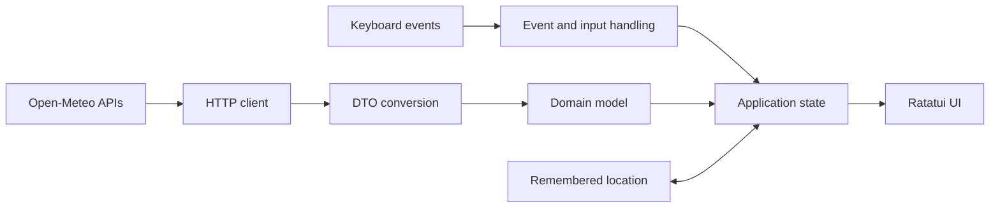

# Virga

[](https://github.com/t-shahan/virga/actions/workflows/ci.yml)
[](#license)

Virga is a responsive Rust terminal weather application for current conditions,
multi-day forecasts, historical context, and hourly conditions visualization.
It is powered by Open-Meteo and requires no account or API key.

> **Project status: actively developed.** Virga works and is worth installing
> today. Features and fixes still land, so expect the occasional release.
> Contributions are welcome.

*Virga* is precipitation that evaporates before it reaches the ground. It is
also, most weeks, what the weathergram charts.

https://github.com/user-attachments/assets/5044c045-0f86-448c-9000-19c9fe541134

## Contents

- [Hourly weathergram](#hourly-weathergram)
- [Highlights](#highlights)
- [Install](#install)
  - [Homebrew](#homebrew)
  - [Install script](#install-script)
  - [Download it yourself](#download-it-yourself)
  - [From source](#from-source)
  - [Updating and removing](#updating-and-removing)
- [Keys](#keys)
- [Commands](#commands)
- [Architecture](#architecture)
- [Engineering Quality](#engineering-quality)
- [Themes](#themes)
- [Where it starts](#where-it-starts)
- [Configuration](#configuration)
- [Contributing](#contributing)
  - [Cutting a release](#cutting-a-release)
- [Limitations](#limitations)
- [Data and Privacy](#data-and-privacy)
  - [Attribution](#attribution)
- [License](#license)

## Hourly weathergram


Press `p` for the hourly view. Sky, temperature, precipitation chance, and wind
share one clock, so a change in the forecast reads down a column instead of
across four separate tables. Temperature stands as a filled silhouette four
rows tall, the chance of rain rises in a band beneath it, a weather emoji
marks the sky every three hours, and the wind row carries an arrow every
second hour. The selected-hour pane gives the exact feels-like temperature,
humidity, rain or snow amount, wind and gusts, and the following 24-hour
precipitation total.

Where the forecast is less certain, the silhouette says so. Virga asks
ECMWF's 51-run ensemble how far its runs disagree about each hour, and draws
a dimmed cap above the temperature as far as nine runs in ten reach. Tomorrow
usually has a crisp edge and day six a hazy one. `▲ 7–13°C` beside the track
is the range most runs give the selected hour.

The visible horizon adapts through 12-, 24-, 36-, and 48-hour tiers as the
terminal widens. Arrow keys still browse the full eight-day hourly forecast,
and tall terminals retain the week-long precipitation strip below the
weathergram.

Prefer the earlier precipitation-centred screen? `v` flips the hourly view to
the classic mirrored chart — chance rising, amount hanging below — and back.
The weathergram is the default; the choice lasts for the session.

## Highlights

- **Current conditions** — temperature, feels-like, wind with gusts and
  direction, precipitation, daylight length, and US air quality index.
- **The next two hours** — when rain or snow is due inside two hours, the
  current pane's bottom border says when it starts and how long it lasts,
  with a bar per quarter hour beside it.
- **Eight-day forecast** — rain chance, maximum wind, UV index, sunrise, and
  sunset.
- **How unusual the day is** — the current pane compares the day's high
  with thirty years of that place's history and says so in a sentence,
  such as `unusually warm, 9°C above normal for mid-November`.
- **Three weeks of context** — fourteen days of historical highs followed by
  the current forecast, so today does not sit alone.
- **Hourly weathergram** — four shared-axis tracks, a selected-hour inspector,
  an adaptive horizon, and an optional weekly precipitation strip.
- **Radar** — `m` opens the last two hours of rain as a looping map in
  braille, over coastlines and borders that are built into the binary, with
  the loop scrubbable frame by frame.
- **Forecast confidence** — a dimmed cap on the temperature silhouette shows
  how far an ensemble's runs disagree, hour by hour, and the selected hour
  states its likely range.
- **Opens on the last forecast** — the forecast from your previous launch is
  on screen before the network answers, marked with its age until the fresh
  one replaces it in place.
- **Fast navigation** — browse days or hours with the arrow keys, jump back to
  now, and inspect the selected period in detail.
- **Starts where you are** — the opening forecast is for the city your IP
  address resolves to, and a city you pick yourself replaces it permanently.
- **City search and live units** — search Open-Meteo's geocoder and switch
  between metric and imperial measurements without restarting.
- **A one-shot report** — `virga now` prints current conditions and today's
  outlook to stdout and exits, for a glance, a script, or a status bar.
- **Terminal-native presentation** — seven foreground-only themes, including
  one for light backgrounds, and responsive behavior down to a 34×12 terminal.

## Install

Virga needs a terminal with Unicode support and an internet connection. It does
not need Rust unless you are building it yourself.

### Homebrew

```bash
brew install t-shahan/virga/virga
```

macOS and Linux. This is the path that needs the least explanation on macOS,
because Homebrew does not apply the Gatekeeper quarantine that stops a binary
downloaded through a browser from opening.

### Install script

```bash
curl -fsSL https://raw.githubusercontent.com/t-shahan/virga/main/install.sh | sh
```

macOS and Linux. It picks the right build for your machine, checks the download
against the release's `SHA256SUMS` before installing anything, and puts the
binary in `~/.local/bin`. Two variables change what it does:

| Variable | Effect |
|---|---|
| `VIRGA_INSTALL_DIR` | Where the binary goes. Default `~/.local/bin` |
| `VIRGA_VERSION` | Install a specific tag, for example `v0.2.0` |

### Download it yourself

Every release on the [releases page][releases] carries a build for Linux
(x86_64 and aarch64, statically linked so distribution does not matter), macOS
(Apple silicon and Intel), and Windows (x86_64). Windows is not covered by the
install script, so the `.zip` is the way in.

Check what you downloaded against `SHA256SUMS`:

```bash
sha256sum --check --ignore-missing SHA256SUMS
```

Every binary also carries a build provenance attestation, which proves it was
produced by this repository's release workflow rather than by someone else:

```bash
gh attestation verify ./virga --repo t-shahan/virga
```

If you downloaded through a browser on macOS, Gatekeeper will refuse to open an
unsigned binary. Clear the quarantine flag:

```bash
xattr -dr com.apple.quarantine ./virga
```

### From source

Building requires **Rust 1.89 or later** — Virga uses `File::lock`, which
stabilized there, to keep concurrent state saves from losing each other's
half.

```bash
cargo install --git https://github.com/t-shahan/virga
```

The binary lands at `~/.cargo/bin/virga`. From a local checkout, use `cargo run
--release`; a plain `cargo run` produces an unoptimized build that is noticeably
slower to render.

### Updating and removing

Virga checks for a newer release once per launch, in the background, and
shows one muted line above the key bar when it finds one. The next keypress
on a screen that shows it clears it — letters typed into the city search
leave it standing, because that screen never shows it — and news that
arrived before you quit is printed on the way out instead. Clearing it is
remembered: the release it named is not announced again, only one newer
than it. Set `VIRGA_UPDATE=off` to skip the check; a launch that cannot
reach GitHub — or that quits before GitHub answers — simply shows no notice.

`virga update` asks the same question on demand and, judging from where the
running binary lives, says which row of this table applies to you. Neither
ever replaces the binary itself:

| Installed with | Update | Remove |
|---|---|---|
| Homebrew | `brew upgrade virga` | `brew uninstall virga` |
| Install script | Re-run the one-liner | `rm ~/.local/bin/virga` |
| Download | Download the new release | Delete the binary |
| Source | `cargo install --git https://github.com/t-shahan/virga --force` | `cargo uninstall virga-tui` |

Uninstalling from source takes the *package* name, `virga-tui`, not the binary
name.

Removing the binary leaves the files Virga writes: a `state.json` holding
the last location you chose and, if you set them, your startup theme and key
bar style, a `forecast.json` holding the last forecast it fetched, and beside
each an empty `.lock` file — `state.json.lock` and `forecast.json.lock` — that
serialises writes to it. All of them live in the platform's per-user state
directory:

| Platform | Directory |
|---|---|
| macOS | `~/Library/Application Support/com.t-shahan.virga/` |
| Linux | `~/.local/state/virga/` |
| Windows | `%LOCALAPPDATA%\t-shahan\virga\data\` |

[releases]: https://github.com/t-shahan/virga/releases/latest

## Keys

| Key | Action |
|---|---|
| `←` `→` | Previous / next day — or hour, on the hourly screen; wraps |
| `↑` `↓` | Back / forward a day — on the hourly screen too, keeping the time of day |
| `n` / `Home` | Jump back to now |
| `p` | Hourly weathergram — `p` again, `b`, `Enter` or `Esc` to go back |
| `m` | Radar: the last two hours, looping — `m` again, `b`, `Enter` or `Esc` to go back |
| `space` | On the radar screen, pause or restart the loop; `←` `→` step a frame and pause it |
| `v` | On the hourly screen, flip between the weathergram and the classic precipitation view |
| `l` | Search for a city (`Enter` selects, `↑` `↓` move, `Esc` cancels) |
| `r` | Refetch the current location — on the radar screen, refetch the radar |
| `u` | Toggle metric / imperial |
| `t` | Cycle the colour theme — the key bar names the one you land on for a few seconds |
| `?` | Every key for the current screen, on a card — any key closes it |
| `,` | Switch the bar between hinting at `?` and naming every binding itself — persisted, like the theme |
| `q` / `Ctrl-C` | Quit — `Esc` too, except on the hourly and search screens, where it only backs out |

The hourly screen puts its four tracks on a shared axis. `▲` marks the selected
hour, a weather emoji marks the sky every three hours, and wind arrows every
second hour carry their speed on the six-hour ticks.

Search results come biggest first. Two that would read the same — one name,
one region, one country — get a second line naming the timezone, or the
coordinates where even that is shared. Choosing a city — or cancelling —
returns to whichever screen the search was opened from.

## Commands

No option changes how Virga runs, since the terminal is the whole interface.
What the command line answers, it answers without starting up.

| Command | What it does |
|---|---|
| `virga` | Start the application |
| `virga now` | Print current conditions and today's outlook for the remembered city |
| `virga now CITY` | The same for a searched city, e.g. `virga now paris`; multi-word names need no quotes |
| `virga theme` | List the themes, marking the startup default with `*` |
| `virga theme NAME` | Persist a startup theme, e.g. `virga theme tokyo night`; multi-word names need no quotes |
| `virga update` | Check whether a newer release exists and print how to get it |
| `virga help` / `-h` / `--help` | Print the usage text |
| `virga version` / `-V` / `--version` | Print the version |

`virga now` is the whole forecast reduced to a glance — the same sources, the
city the app remembers, and none of the terminal:

```
$ virga now
Frederick, Maryland, United States · Partly cloudy
75°F, feels like 78°F · wind 7 mph · AQI 42 Good
Today: 84°F / 63°F · rain 20% · UV 6 · sun 06:24–20:07
```

A city whose clocks disagree with the machine's says what time it is there
on the first line, as `· local time 21:30 (UTC+09:00)`; a city on the same
clock says nothing about it.

When rain or snow is due within two hours, a fourth line says so, in the
words the app uses: `Rain in about 30 min, lasting 45`, `Rain stopping in
about 15 min`, or `Snow through the next two hours`. A dry two hours prints
nothing, so the report is three lines on most days and four on some.

Plain lines on stdout, so a script or a status bar reads it as easily as a
person does; a reading the provider did not report simply does not appear.
Set `VIRGA_UNITS=metric` to change what a degree is, here and on the app's
first frame. Asking about a named city is a question, not a move — the
remembered city stays whatever it was. And when nothing is remembered yet,
the one location lookup `virga now` makes is remembered afterwards, so a
status bar polling by the minute asks the location provider once, not once
per poll. That is the one place the two disagree: the app re-detects a
detected location on every launch, and `virga now` never does, so after
travelling it keeps reporting the old city until the next launch overwrites
it. A lookup the provider does not answer is remembered too, for a quarter
of an hour: the report names the fallback city meanwhile, and asks again
once that has passed. When the app fetched a forecast for the remembered
city within the last hour, `virga now` answers from it, moved to the current
hour, without asking the network; a named city always fetches, and
`VIRGA_CACHE=off` turns this off along with the rest of the cache.

An unknown argument is an error rather than something to skip past. A typo
would otherwise start the application while the question behind it went
unanswered. Neither `virga update` nor the startup check replaces the binary; see
[Updating and removing](#updating-and-removing) for the command that does, and
[Configuration](#configuration) for the four environment variables.

## Architecture

Virga separates provider-specific data and network activity from application
state and terminal rendering:



- [`src/ui/`](src/ui/) renders application state with Ratatui and performs no
  networking.
- [`src/weather/client.rs`](src/weather/client.rs) owns the weather,
  air-quality, and geocoding HTTP requests.
- [`src/weather/radar.rs`](src/weather/radar.rs) fetches RainViewer's radar
  pictures and reduces each to a grid of intensity levels, so no pixel
  colour reaches the UI. [`src/outline.rs`](src/outline.rs) reads the
  embedded coastlines drawn under them.
- [`src/weather/dto.rs`](src/weather/dto.rs) isolates Open-Meteo's wire formats
  and converts them into the stable domain data in
  [`src/weather/model.rs`](src/weather/model.rs).
- Event and input handling update application state, which coordinates
  navigation, search, refreshes, units, themes, and remembered location.

This boundary keeps provider changes out of the UI and makes both rendering and
API conversion independently testable.

## Engineering Quality

Virga's default locked test suite passes **several hundred deterministic
tests**; four provider-dependent live tests — two against Open-Meteo, one
against ipapi.co, one against GitHub's release redirect — are ignored during
normal runs.
Coverage includes:

- deterministic rendering checks built with Ratatui's `TestBackend`, including
  narrow and awkward terminal sizes;
- navigation wraparound, selection invariants, and metric/imperial conversion
  boundaries;
- null, malformed, truncated, and mismatched API-response handling;
- loopback-server tests proving refused and silent connections fail or time out
  instead of blocking the interface; and
- state persistence, input filtering, themes, charts, and stale asynchronous
  response handling.

GitHub Actions runs the locked suite on Linux, macOS, and Windows. Separate
gates enforce rustfmt, Clippy with warnings denied, the Rust 1.89 minimum
supported version, package-content completeness, and pinned dependency audits.
One more reads `CHANGELOG.md`: a section that has shipped may not be edited,
and a change a user can observe must describe itself under the section that
will carry it.

## Themes

`t` steps through seven palettes from either weather screen. The key bar names
the one you land on — `[t] theme (nord)` — and drops the name again a few
seconds later, so cycling tells you where you are without leaving a permanent
readout.

| Theme | Notes |
|---|---|
| `default` | Bright slots from the sixteen ANSI colours, so Virga stays legible while following your terminal's configured palette |
| `gruvbox dark` | Warm throughout — orange bars, gold selection, green today |
| `nord` | Cool throughout — icy bars, aurora-purple selection |
| `tokyo night` | Blue and violet, with the selection the one warm thing on screen |
| `dracula` | The loud one — pink bars, lime selection, cyan today |
| `catppuccin mocha` | Pastel — mauve bars, sky selection, yellow today |
| `catppuccin latte` | The same scheme in dark ink, for terminals with a light background |

Every palette sets foregrounds only. None paints a background: your terminal's
own background remains visible, so a theme layers over your existing scheme
instead of stamping a separate dark rectangle over it. That also means a
palette has to suit the ground it lands on — `catppuccin latte` is the one
built for a light background, and the others assume a dark one.

The six non-default palettes use their exact 24-bit colours when the terminal
advertises truecolor through `COLORTERM` or `TERM`. On a 256-colour terminal,
Virga maps them to the closest xterm palette entries; on a sixteen-colour or
unknown terminal, each theme has an intentional ANSI approximation that keeps
its series, selection, and current-time colours distinct. `default` remains the
default, so the first frame always uses the terminal's own configured colours.

Detection is capability-based rather than tied to terminal or operating-system
names. That lets Terminal.app and other basic terminals receive compatible
colours while Ghostty, Kitty, and other truecolor terminals keep the exact
palette, and it leaves one isolated detection boundary for future platforms.

To make a theme the startup default, persist it:

```bash
virga theme tokyo night
```

`virga theme` alone lists the palettes and marks the one the next launch will
use. Names are case-insensitive and forgiving about separators, so `tokyo
night`, `tokyo-night`, and `Tokyo_Night` select the same theme, and multi-word
names need no quotes.

`VIRGA_THEME` still works and outranks the persisted theme for one launch:

```bash
VIRGA_THEME=gruvbox-dark virga
```

From weakest to strongest, the startup theme is the built-in `default`, the
persisted theme, `VIRGA_THEME`, and whatever `t` lands on — which lasts for
the session only, so cycling is a preview rather than a commitment. An
unrecognized `VIRGA_THEME` prints the known themes and falls back to the
persisted theme rather than refusing to run.

## Where it starts

Virga starts where your IP address says you are, so the first thing on screen is
your own weather rather than a city chosen for you.

Press `l` and pick somewhere, and that becomes the answer for good: a location
you chose is remembered in the platform's per-user state/data directory, and
every later launch starts there without asking the network anything. Detection
only runs while you have not chosen.

When the lookup does not answer — no network, or the service having a bad day —
Virga falls back to the last place it detected, and to New York City if it has
never detected one. The reason is printed on exit rather than shown as an error,
because a worse guess is not a reason to withhold the forecast.

Set `VIRGA_GEOIP=off` to skip the lookup entirely:

```bash
VIRGA_GEOIP=off virga
```

Startup is then the last location Virga knew, or New York City. An unrecognized
value prints a warning and leaves detection on rather than refusing to run.

### The first frame

With a remembered city, the first frame is the forecast from your previous
launch, read from `forecast.json` before the terminal is taken over. Its
bottom border says when it was fetched, `as of 17:52 · updating`, and the
fresh forecast replaces the numbers in place when it lands, usually within a
second. A forecast more than 24 hours old, or for a different city, is not
shown; the launch then opens on the panes themselves, empty — the city in
its corner, the `Forecast` and `Daily Highs` headings, and the key bar —
with the spinner inside the forecast pane, and the readings fill the boxes
already on screen when they land. If the fetch fails the forecast stays,
marked `refresh failed, r to retry`, rather than giving way to an error
popup. `r` behaves the same way: the forecast stays up while its
replacement is fetched.

Set `VIRGA_CACHE=off` to keep the forecast off disk and open on the empty
panes:

```bash
VIRGA_CACHE=off virga
```

## Configuration

`virga theme` persists the startup palette, `VIRGA_THEME` overrides it for one
launch, `VIRGA_GEOIP` turns location detection off, `VIRGA_UPDATE` turns the
startup release check off, and `VIRGA_CACHE` turns the on-disk forecast off,
all as described above. `VIRGA_UNITS` picks
`metric` or `imperial` — `celsius`/`c` and `fahrenheit`/`f` also answer — for
the `virga now` report and the app's first frame alike; imperial when unset,
which is what the app has always started in. Unit and theme changes made in
the app last for the session.

Nothing else is configurable. The command line takes no options at all, only
the questions [Commands](#commands) lists.

## Contributing

Bug fixes, documentation improvements, tests, accessibility work, and
well-scoped features are welcome. Please open an issue before beginning a
substantial change so the approach and scope can be discussed. This is a
side project, so review timing varies, but pull requests do get read.

Before opening a pull request, run the same core checks used by CI:

```bash
cargo fmt --check
cargo clippy --all-targets --locked -- -D warnings
cargo test --locked --all-targets
cargo package --locked
```

Opening a pull request fills in a template. Keep its `Review focus` section
and say where the review should look hardest, because that is the part a
reviewer cannot reconstruct from the diff. Either way, Claude reviews a pull
request that a person opens from a branch in this repository against the
requirements in [`CLAUDE.md`](CLAUDE.md), so the section directs the review
rather than triggering it. A pull request from a fork runs without the
secret the review needs, and a push by a bot is one the review declines to
act on, so the check is skipped in both cases rather than failed; the review
happens when a maintainer looks.

Mentioning `@claude` is a separate thing and always optional. It hands the
work to the interactive agent, which answers questions and can run the cargo
gates, and it is read from a pull request description, a comment, or an issue.
Mentions added by editing count, so a request is no longer lost by being typed
a moment too late.

Notable changes belong in [`CHANGELOG.md`](CHANGELOG.md) under `Unreleased`.
That is not bookkeeping for its own sake: release notes are generated from that
file, and both the release script and CI refuse to publish a version it does not
describe.

### Manual render check

CI compiles and tests on all three platforms but never looks at a terminal,
so a change to layout or drawing is checked by eye before it merges, in at
least one of the terminals named under [Limitations](#limitations):

- Every screen at the floor size, 34×12 and 36×19 for the hourly
  weathergram, and at a wide one.
- The hourly weathergram's `┬` under the current hour and `▲` under the
  selected hour sit beneath their columns at the one-, two-, and three-cell
  hour widths, and the classic chart's `┬` and `═` match.
- On the radar screen (`m`), the coastline around a coastal city is where a
  map says it is, the `◉` sits on the city, the loop advances about twice a
  second and rests on the newest frame, and braille cells line up with no
  gaps between rows. A font without the braille block shows boxes, which is
  a font problem and worth noting which font.
- The `▲`, `┬`, `═`, `◉`, and box-drawing borders are East Asian
  ambiguous-width glyphs. In a terminal that draws those two cells wide,
  such as one set to an East Asian locale, the hourly views' markers still
  sit under their columns, the week strip's rows still share one axis, and
  the radar's `◉` does not push its row of the map sideways.

### Cutting a release

```bash
./scripts/release.sh 0.3.0
```

It checks the working tree, bumps the manifest, runs the four gates above, then
commits, tags, and pushes. From there
[`.github/workflows/release.yml`](.github/workflows/release.yml) builds all five
platforms, publishes the release with checksums and build provenance, and
updates the Homebrew tap. The tap push authenticates with a `TAP_KEY` secret
holding an SSH private key whose public half is a write-enabled deploy key on
[the tap repository](https://github.com/t-shahan/homebrew-virga). A deploy key
rather than a personal access token, because it grants write to that one
repository and nothing else, and does not expire. Without the secret the release
still publishes and only the tap update is skipped, with a warning.

## Limitations

- There is no general configuration file. Every launch fetches fresh weather;
  the previous launch's forecast is shown, labelled with its age, only until
  the fetch answers, and only when it is under a day old. The startup theme,
  key bar style, and location are persisted, and units follow `VIRGA_UNITS`
  at startup and last for the session.
- Detection is city-level and sometimes wrong. Behind a VPN or a carrier-grade
  NAT it lands near your provider rather than near you — `l` fixes that
  permanently, and `VIRGA_GEOIP=off` avoids the lookup altogether.
- The two-hour precipitation sentence reads Open-Meteo's 15-minute series,
  which is native model data over North America and central Europe and
  interpolated from the hourly forecast elsewhere. The response does not say
  which, so the sentence says "about" everywhere. Its minutes are counted
  from the start of the quarter hour in progress, so they can overstate the
  wait by up to a quarter hour. The sentence moves on as the app sits open,
  and gives way to the comparison once the fetched two hours have passed;
  `r` fetches the next two.
- The confidence cap is drawn with the terminal's dim attribute. A terminal
  that ignores it shows the cap at full strength, as a taller silhouette.
  The cap only rises: uncertainty below the forecast is in the `▲` range
  and not in the drawing. It also starts on the row above the one the
  forecast's surface is in, so doubt that ends inside that row draws
  nothing, and how much doubt that hides depends on where in the row the
  surface sits.
- "Normal" is the mean daily high for 1991 to 2020 over the fifteen days
  around the date, from Open-Meteo's archive, which is a reanalysis and not
  a weather station. It is a coarser model than the forecast, so the table
  is shifted by the average difference between the two over the last days
  both describe. With fewer than three such days the shift is zero, and a
  hillside or a coast can then read a degree or two off. "Unusually" means
  the high is outside the range nineteen days in twenty fell in. Only the
  high is compared. Until the table arrives, with `VIRGA_CACHE=off`, or if
  the archive request fails, the pane compares the day with the three weeks
  on screen as it did before.
- The radar is a picture from RainViewer, read back into five bands of
  intensity by its colours, so it shows where and roughly how hard, and no
  rainfall rate. It covers the last two hours only; RainViewer no longer
  serves a forecast. Where no radar station reaches, which is most ocean
  and much of Africa and Asia, the map is empty, and an empty map cannot
  tell "dry" from "not covered". If frames fail to arrive the loop is shown
  without them and the border counts them. Frames are reused for ten
  minutes; after that, reopening the screen fetches again. The faint scattered dots are echoes below
  the palette's first solid colour and are often not rain reaching the
  ground. The view is fixed at about 380 km across at mid-latitudes and
  does not zoom or pan. The outline is Natural Earth's 1:50m data: fine
  for a coast, too coarse for a harbour, and without rivers, roads or
  place names. Each frame's time is on the forecast place's clock. The
  screen needs a font with the braille block, and is the one screen where a
  terminal without colour loses information that density only partly keeps.
- The ensemble is a coarser model than the forecast, so only how much its
  runs disagree is used, centred on the forecast's own temperature.
- Forecast text is English only.
- Terminals below 34×12 show a size warning instead of the interface. The
  hourly weathergram needs 36 columns and 19 rows above the key bar, and
  shows the same warning below that.
- “Today” is distinguished by colour alone in the daily chart. The current
  hour is not: both hourly views hang a `┬` under it, which the selection
  marker covers while the selection sits there, and the week strip sets it in
  bold. Nor is the selection: every screen marks it by shape as well — a `>`
  in the forecast table's gutter and before the week strip's day, and a `▲`
  in the hourly weathergram.
- Ghostty and Apple's Terminal app have been tested manually on macOS.
- Automated tests run on Linux, macOS, and Windows. They do not validate
  real-terminal rendering, font fallback, or held-key behavior.

## Data and Privacy

Weather, air quality, and geocoding all come from
[Open-Meteo](https://open-meteo.com), which needs no API key. Its free tier is
**for non-commercial use only** and is rate limited to 10,000 calls per day.
Each weather load makes three requests — the forecast, air quality, and the
ensemble behind the confidence band — and each submitted search makes one
more. `virga now` draws no band and skips the ensemble — two requests per report,
one more for a named city, and the location lookup only on a first run where
nothing is remembered — or none, when the app's last forecast for the city
is under an hour old.

The first time the app loads a place it also asks Open-Meteo's archive once
for that place's daily highs from 1991 to 2020, and in a second, small
request for the last month. The first is by far the largest thing Virga
asks for: Open-Meteo weighs a request by its span, and thirty years of one
variable counts as several hundred calls against the daily allowance. Virga reduces the answer to a table of 366 rows and keeps it in
`normals.json` in the state directory, for the eight places used most
recently, so a place is asked about once and not once per launch. A request
that fails is not repeated until the next launch. With
`VIRGA_CACHE=off` there is nowhere to keep the table and the request is not
made. `virga now` never makes it.

Opening the radar screen makes fourteen requests to
[RainViewer](https://www.rainviewer.com): one for the list of frames and one
for each of the thirteen pictures. They are made when you press `m` or
refresh the radar, never at launch. Each picture request carries the
location rounded to a tenth of a degree, about eleven kilometres, which is
all a 380 km picture needs. RainViewer's free API needs no key and its
[terms](https://www.rainviewer.com/api.html) allow personal and educational
use only, so a commercial deployment of Virga would need its own
arrangement with them. Nothing from RainViewer is written to disk.

Location detection is the other thing that does not go to Open-Meteo. On a launch
where you have not chosen a city, Virga makes a single request to
[ipapi.co](https://ipapi.co), which resolves the connection's own source address
to a city. Nothing else is sent — no query string, no identifier, no
coordinates, because working the coordinates out is the point of the request.
Their free tier needs no API key and allows 1,000 requests a day; Virga makes at
most one per launch. See ipapi.co's [privacy
policy](https://ipapi.co/privacy/) for what they retain.

That request is not made at all once you have chosen a city, or with
`VIRGA_GEOIP=off` set.

The last forecast fetched is written to `forecast.json` in the state
directory, alongside the coordinates it describes and the time it was
fetched, so the next launch can open on it. It is read by Virga alone and
never sent anywhere. `VIRGA_CACHE=off` stops it being written or read, and
does the same for `normals.json`, which holds coordinates and the table of
normals for each of up to eight places and nothing else.

Checking for a newer release makes one request to GitHub's release-redirect
endpoint at github.com, carrying nothing Virga puts there: no version
string, no identifier. The answer is read from a response header, and no
release page or file is downloaded. The check runs once per launch in the
background and whenever you run `virga update`; set `VIRGA_UPDATE=off` and
the launch-time request is not made at all.

Every request, to any of these hosts, goes out with the HTTP library's own
default `User-Agent`, which names the library and its version, not Virga.

Virga stores only the last successfully loaded location label and coordinates
locally, in its per-user state/data directory, alongside a note of whether you
chose it or it was detected — and, if you set them, the name of your startup
theme (with `virga theme`), your key bar style (with `,`), and the version of
the last update notice you cleared. Your IP address is never written to disk —
the resolved city is. It does not store weather responses, searches, or
history.
Weather and air-quality requests send the location coordinates to Open-Meteo;
city searches submit their search text to its geocoder. Open-Meteo's
free-service logs may retain IP addresses and coordinates for 90 days. See
Open-Meteo's [terms](https://open-meteo.com/en/terms) and
[licence](https://open-meteo.com/en/license).

### Attribution

Weather data by [Open-Meteo](https://open-meteo.com), licensed
[CC BY 4.0](https://creativecommons.org/licenses/by/4.0/). Air-quality data is
served by Open-Meteo from the Copernicus Atmosphere Monitoring Service (CAMS),
whose [Air Quality API](https://open-meteo.com/en/docs/air-quality-api)
requires that both be credited. The daily highs behind the normals come from
Open-Meteo's [Historical Weather API](https://open-meteo.com/en/docs/historical-weather-api),
which serves reanalysis from the Copernicus Climate Change Service and ECMWF.

Radar data by [RainViewer](https://www.rainviewer.com), credited on the radar
screen's border as its terms require. The coastlines, borders and lakes under
it are made with [Natural Earth](https://www.naturalearthdata.com), which is
in the public domain; `scripts/build-outline.py` packs them into
`src/outline.bin`.

<details>
<summary>Full CAMS citation</summary>

> METEO FRANCE, Institut national de l'environnement industriel et des risques
> (Ineris), Aarhus University, Norwegian Meteorological Institute (MET Norway),
> Jülich Institut für Energie- und Klimaforschung (IEK), Institute of
> Environmental Protection – National Research Institute (IEP-NRI), Koninklijk
> Nederlands Meteorologisch Instituut (KNMI), Nederlandse Organisatie voor
> toegepast-natuurwetenschappelijk onderzoek (TNO), Swedish Meteorological and
> Hydrological Institute (SMHI), Finnish Meteorological Institute (FMI),
> Italian National Agency for New Technologies, Energy and Sustainable Economic
> Development (ENEA) and Barcelona Supercomputing Center (BSC) (2022): CAMS
> European air quality forecasts, ENSEMBLE data. Copernicus Atmosphere
> Monitoring Service (CAMS) Atmosphere Data Store (ADS). (Updated twice daily).
>
> All users of Open-Meteo data must provide a clear attribution to CAMS
> ENSEMBLE data provider as well as a reference to Open-Meteo.

</details>

## License

Licensed under either of

- Apache License, Version 2.0 ([LICENSE-APACHE](LICENSE-APACHE) or
  <http://www.apache.org/licenses/LICENSE-2.0>)
- MIT license ([LICENSE-MIT](LICENSE-MIT) or
  <http://opensource.org/licenses/MIT>)

at your option. This covers the program's own source, which is separate from
the licensing of the data it fetches — see [Data and Privacy](#data-and-privacy).

Unless you explicitly state otherwise, any contribution intentionally submitted
for inclusion in this crate by you, as defined in the Apache-2.0 license, shall
be dual licensed as above, without any additional terms or conditions.
